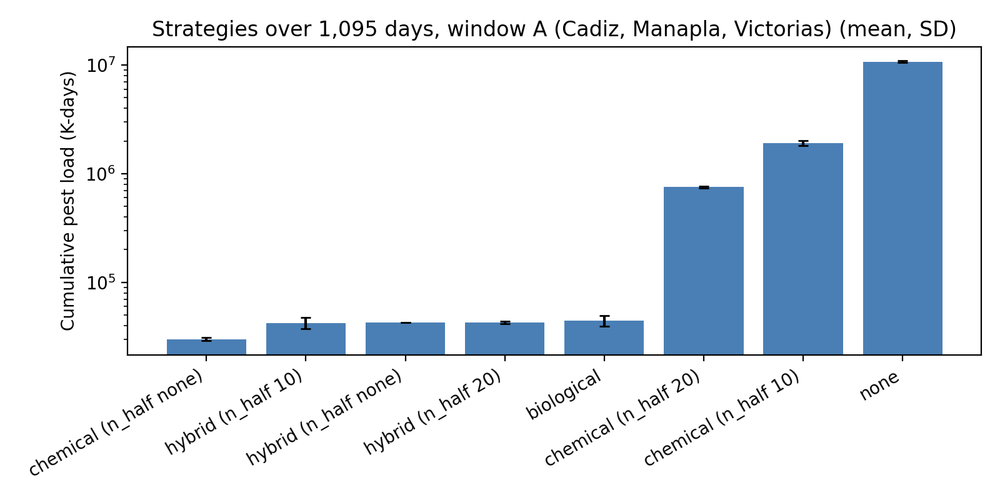

# RSSI batch results: summary

Source folder: `results/A`. Generated by `analysis/analyse_results.py` from the run CSVs.

## 1. Main comparison

| Rank | Configuration | n | Cumulative pest load, K-days: mean (SD) [min-max] | Share ever infested | Share infested at end | Chemical apps | Biological apps | Cane t/ha | Max density (K) |
|---|---|---|---|---|---|---|---|---|---|
| 1 | chemical (n_half none) | 2 | 30,013 (1,024) [29,289-30,738] | 0.192 | 0.078 | 34,882 | 0 | 61.63 | 0.103 |
| 2 | hybrid (n_half 10) | 2 | 42,379 (4,789) [38,992-45,765] | 0.249 | 0.110 | 0 | 52,891 | 61.62 | 0.111 |
| 3 | hybrid (n_half none) | 2 | 42,777 (145) [42,675-42,880] | 0.258 | 0.111 | 0 | 52,902 | 61.62 | 0.116 |
| 4 | hybrid (n_half 20) | 2 | 42,789 (1,021) [42,067-43,511] | 0.256 | 0.111 | 0 | 53,128 | 61.62 | 0.115 |
| 5 | biological | 2 | 44,123 (4,959) [40,616-47,629] | 0.263 | 0.115 | 0 | 54,588 | 61.62 | 0.116 |
| 6 | chemical (n_half 20) | 2 | 754,011 (17,092) [741,924-766,097] | 0.340 | 0.275 | 85,602 | 0 | 61.37 | 0.956 |
| 7 | chemical (n_half 10) | 2 | 1,919,710 (110,037) [1,841,902-1,997,518] | 0.491 | 0.438 | 125,474 | 0 | 60.92 | 0.983 |
| 8 | none | 2 | 10,763,962 (222,266) [10,606,796-10,921,127] | 0.965 | 0.963 | 0 | 0 | 57.24 | 1.039 |

Lower load ranks first. Applications count farm-level treatment events (one per farm), not hectares.

## 2. One-at-a-time sensitivity

Mean cumulative pest load per strategy (n = 1-1 runs per cell: a screen, not an estimate). 'Ranking' lists strategies from lowest to highest load; 'changes?' compares with the baseline ranking of section 1 (n_half 20, 2 replicates: biological ≈ hybrid < chemical < none). Strategies within 16% of each other are shown as tied (≈): the largest relative range between the 2 replicates of any configuration in section 1.

| Case | Assumption changed | none | chemical | biological | hybrid | Ranking | Changes? |
|---|---|---|---|---|---|---|---|
| 0 | baseline | 11,137,303 | 765,954 | 39,987 | 47,688 | biological < hybrid < chemical < none | **yes** |
| 1 | settlement survival 0.01 | 411,239 | 8,431 | 11,459 | 10,288 | chemical < biological ≈ hybrid < none | **yes** |
| 2 | settlement survival 0.10 | 14,362,113 | 2,589,283 | 87,066 | 88,662 | biological ≈ hybrid < chemical < none | no |
| 3 | neighbour transmission x0.25 | 4,859,478 | 217,053 | 10,337 | 10,471 | biological ≈ hybrid < chemical < none | no |
| 4 | neighbour transmission x4 | 18,539,985 | 5,652,009 | 213,617 | 213,370 | biological ≈ hybrid < chemical < none | no |
| 5 | long jump 0 | 8,152,258 | 735,409 | 34,591 | 31,694 | biological ≈ hybrid < chemical < none | no |
| 6 | long jump 0.2 | 14,031,188 | 951,911 | 63,478 | 64,751 | biological ≈ hybrid < chemical < none | no |
| 7 | parasitism 0 | 14,218,744 | 1,761,568 | 63,843 | 63,231 | biological ≈ hybrid < chemical < none | no |
| 8 | parasitism 0.668 | 5,195,139 | 53,620 | 23,034 | 21,837 | biological ≈ hybrid < chemical < none | no |
| 9 | bio:chem ratio 0.8 | 10,685,025 | 812,833 | 56,613 | 55,556 | biological ≈ hybrid < chemical < none | no |
| 10 | bio:chem ratio 1.0 | 11,152,748 | 733,547 | 28,925 | 31,166 | biological ≈ hybrid < chemical < none | no |
| 11 | level thresholds x0.5 (200 insects/leaf = K) | 11,104,287 | 633,463 | 12,010 | 11,532 | biological ≈ hybrid < chemical < none | no |
| 12 | level thresholds x2 (50 insects/leaf = K) | 10,637,171 | 1,184,061 | 134,553 | 126,867 | biological ≈ hybrid < chemical < none | no |
| 13 | trigger T = 2 | 10,463,667 | 2,142,568 | 706,104 | 675,953 | biological ≈ hybrid < chemical < none | no |
| 14 | trigger T = 3 | 11,293,037 | 2,863,387 | 1,410,472 | 2,864,396 | biological < chemical ≈ hybrid < none | **yes** |
| 15 | re-treatment 7 d | 11,350,409 | 1,667,942 | 37,992 | 34,558 | biological ≈ hybrid < chemical < none | no |
| 16 | re-treatment 28 d | 10,725,663 | 2,186,813 | 1,059,670 | 1,357,719 | biological < hybrid < chemical < none | **yes** |
| 17 | wind bias 0.5 | 11,131,260 | 709,650 | 43,548 | 42,653 | biological ≈ hybrid < chemical < none | no |
| 18 | wind bias 1.0 | 9,927,698 | 687,493 | 39,855 | 38,991 | biological ≈ hybrid < chemical < none | no |

## 6. Wind direction (bias 1.0): 135 (from NE) vs 315 (from SW)

| Strategy | Load at 135: mean (SD) | Load at 315: mean (SD) | Difference / larger SD |
|---|---|---|---|
| biological | 39,537 (2,880) | 38,132 (4,038) | 0.3 |
| chemical | 640,478 (19,625) | 666,400 (11,694) | 1.3 |
| hybrid | 36,674 (85) | 40,837 (2,918) | 1.4 |
| none | 9,995,631 (106,315) | 9,683,729 (312,865) | 1.0 |

A ratio below about 2 means direction makes no difference beyond run-to-run spread [rule of thumb].

## 7. Saturating damage (check)

| Rank | Configuration | n | Cumulative pest load, K-days: mean (SD) [min-max] | Share ever infested | Share infested at end | Chemical apps | Biological apps | Cane t/ha | Max density (K) |
|---|---|---|---|---|---|---|---|---|---|
| 1 | biological | 2 | 42,516 (2,120) [41,017-44,015] | 0.253 | 0.110 | 0 | 53,095 | 61.62 | 0.107 |
| 2 | hybrid (n_half 20) | 2 | 44,385 (4,620) [41,118-47,651] | 0.260 | 0.113 | 0 | 54,830 | 61.62 | 0.115 |
| 3 | chemical (n_half 20) | 2 | 802,936 (62,079) [759,040-846,833] | 0.353 | 0.288 | 88,941 | 0 | 61.37 | 0.947 |
| 4 | none | 2 | 10,866,730 (29,218) [10,846,070-10,887,390] | 0.964 | 0.963 | 0 | 0 | 57.60 | 1.025 |

Compare the ranking with section 1 at n_half 20: the damage form should not change the ranking by pest load.

