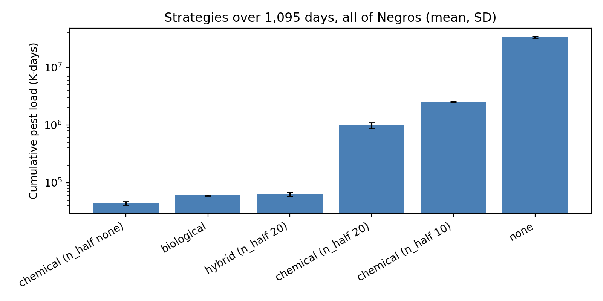
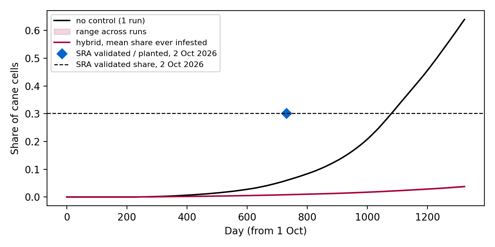
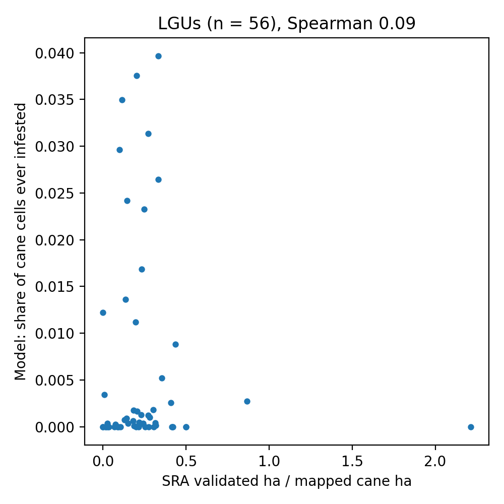

# RSSI batch results: summary

Source folder: `results/seeded`. Generated by `analysis/analyse_results.py` from the run CSVs.

## 1. Main comparison

| Rank | Configuration | n | Cumulative pest load, K-days: mean (SD) [min-max] | Share ever infested | Share infested at end | Chemical apps | Biological apps | Cane t/ha | Max density (K) |
|---|---|---|---|---|---|---|---|---|---|
| 1 | chemical (n_half none) | 2 | 43,950 (3,127) [41,739-46,161] | 0.027 | 0.011 | 48,560 | 0 | 61.64 | 0.096 |
| 2 | biological | 2 | 60,394 (1,355) [59,436-61,352] | 0.036 | 0.016 | 0 | 71,334 | 61.64 | 0.116 |
| 3 | hybrid (n_half 20) | 2 | 63,067 (5,114) [59,451-66,683] | 0.038 | 0.017 | 0 | 73,889 | 61.64 | 0.118 |
| 4 | chemical (n_half 20) | 2 | 982,778 (121,261) [897,033-1,068,523] | 0.051 | 0.040 | 117,911 | 0 | 61.61 | 0.950 |
| 5 | chemical (n_half 10) | 2 | 2,539,217 (48,398) [2,504,994-2,573,439] | 0.082 | 0.069 | 178,486 | 0 | 61.56 | 0.990 |
| 6 | none | 3 | 33,213,080 (1,039,826) [32,013,127-33,849,414] | 0.638 | 0.623 | 0 | 0 | 60.59 | 1.034 |

Lower load ranks first. Applications count farm-level treatment events (one per farm), not hectares.

## 3. Time-scale check (hybrid, baseline)

Reference: SRA validated RSSI area on 2 Oct 2026 = 30.1% of Negros planted cane (FOI). The model's share is of mapped cane cells, which over-represent planted area about 1.5 times.

- Mean share ever infested reaches 30.1% on day **never (within the horizon)**.
- At the end: mean 0.038 (range 0.036-0.040).

- Seeded run: on day 728 (week of 2 Oct 2026; seeds on day 233 = 22 May 2025) mean share ever infested = 0.008 vs SRA 0.301.

A time-scale check only: the observed area was under treatment and partly reflects validation effort (Ch3 3.6.2).

No-control run with the same seeded start (1 run; upper bound of the model for this date):

- Share ever infested in the week of 2 Oct 2026 (day 728): none 0.059, hybrid 0.008, SRA 0.301 of planted cane.
- In hectares (1 cell = 1 ha, 356,869 mapped cane cells): none 20,933, hybrid 2,876, SRA validated 72,103.
- None reaches 30.1% on day 1085 (2 Oct 2026 = day 731).

The observed area is above BOTH model curves: the model spreads too slowly at baseline even without control. Not a validation; spread parameters and the seed size are uncalibrated.

## 3b. Severity split among infested farms vs PGNO survey (weak pattern)

Model: hybrid, seeded, mean over weeks in days 659-768 (22 Jul-8 Nov 2026). PGNO: farmlots with RSSI found, as of 8 Nov 2026. The survey expanded coverage over time (High fell from 28% to 15% as it grew), so this is a face-validation pattern only.

| Level | Model | PGNO |
|---|---|---|
| 1 Low | 100.0% | 52.8% |
| 2 Moderate | 0.0% | 30.8% |
| 3 High | 0.0% | 16.4% |

## 4. Per-municipality comparison with SRA (FOI Table I)

56 LGUs with cane and an SRA row. Spearman rank correlation between model share ever infested and SRA validated share of mapped cane: **0.09**; without the 11 seed LGUs (n = 45): **0.10**.

Seeded start (87 cells in the 11 LGUs of 22 May 2025), model read on day 731 = 2 Oct 2026, the FOI date. The 11 seed LGUs start ahead by construction; the test is whether spread from them reproduces the rest of the ranking.

